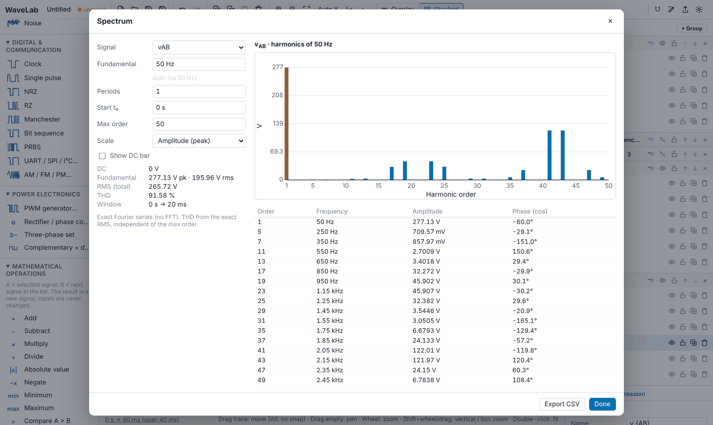
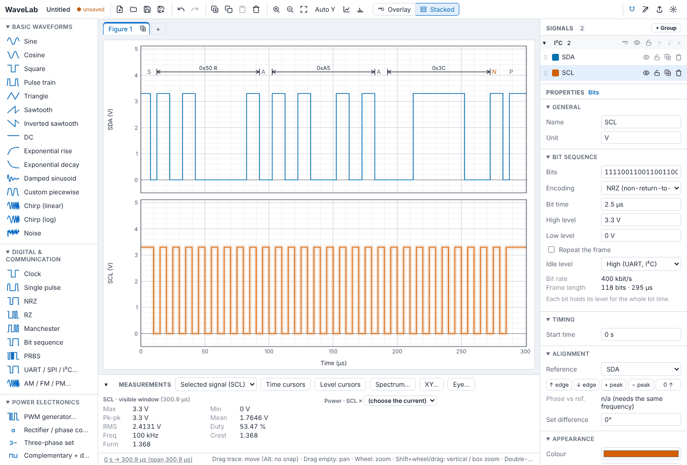
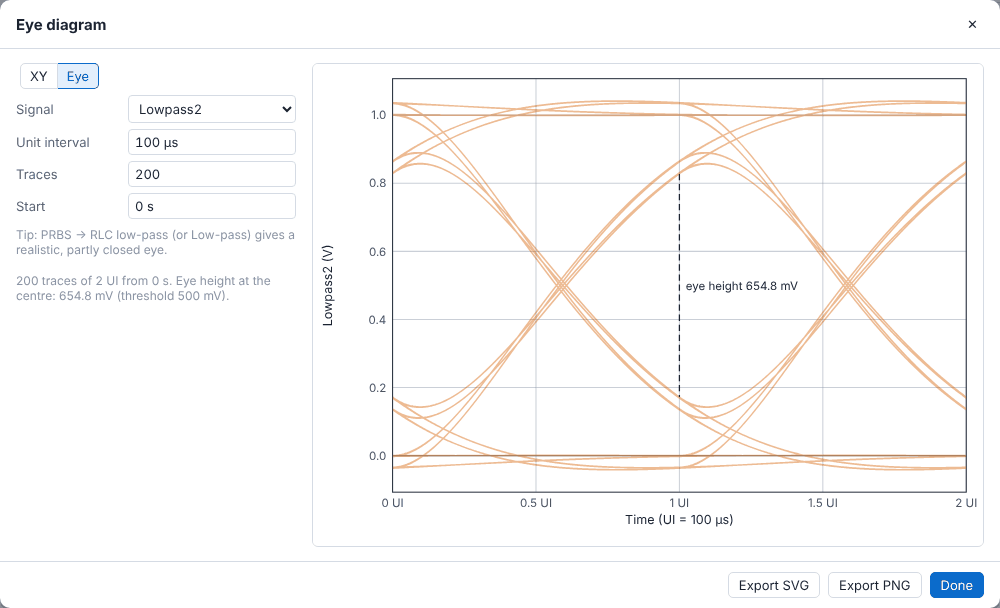

# WaveLab

**Exact waveforms for engineers, teachers and students — right in the browser.**

WaveLab is a waveform editor and analyser in which every signal is a *mathematical object*, not a drawing
or a list of samples. Build signals from generators and expressions, measure them exactly, look at their
spectrum, and export publication-quality figures (PNG, SVG, PDF, TikZ). Nothing to install, no account, no
server: everything runs locally in your browser.

**▶ Open the app: <https://gaetanolongo.github.io/WaveLab/>**


---

## Contents
- [Why WaveLab](#why-wavelab)
- [Quick start](#quick-start)
- [Feature tour](#feature-tour)
- [Expression language](#expression-language)
- [Mouse, touch and keyboard](#mouse-touch-and-keyboard)
- [Accuracy, conventions and limits](#accuracy-conventions-and-limits)
- [Files, privacy and recovery](#files-privacy-and-recovery)
- [Development](#development)
- [Roadmap and history](#roadmap-and-history)
- [Credits and licence](#credits-and-licence)

## Why WaveLab
- **Exact, not sampled.** Edges are true vertical jumps, extrema are solved analytically, integrals use
  closed forms or adaptive quadrature. Mean, RMS, duty cycle, THD, power factor… are computed from the
  mathematics, so a 50 % square wave reads 50.00 %, not 49.87 %.
- **Everything stays editable.** A PWM set, a rectifier or an I²C frame is just a group of ordinary signals
  and expressions (`G_A = v_ref > carrier`). Change one parameter and everything downstream updates.
- **Made for figures.** Overlay or stacked plots, groups, several figures and grids, style presets, math in
  labels, annotations and dimension markers; the same renderer draws the screen and every export.
- **Private and offline-friendly.** Projects are small readable JSON files on your disk. Nothing is uploaded.

## Quick start
1. Open the app and click **Sine** in the toolbox (left). A 50 Hz, 1 V sine appears.
2. Edit it on the right: type `325` in *Amplitude* or `60` in *Phase*. Numbers accept SI prefixes:
   `2.5m`, `10k`, `400u`.
3. Add a **Square**, select the sine, then click **Add** under *Mathematical operations*. You get
   `Sum = Sine + Square`, an expression you can edit.
4. Drag a trace to move it in time (it snaps to edges, peaks and zero crossings; hold **Alt** for free).
   Scroll to zoom, drag the background to pan, double-click to fit.
5. Turn on **Time cursors** in the Measurements bar: Δt, 1/Δt and exact interval measurements appear.
6. **Ctrl+S** saves a `.wlab` project; **Ctrl+Shift+S** exports PNG / SVG / PDF / CSV / TikZ.

> Tip: hover any button or field for an explanation; the *Syntax help* section of an expression lists every
> function.

## Feature tour

### Waveforms
| Group | Waveforms |
|---|---|
| Basic | sine, cosine, square, pulse train (rise/fall, SPICE convention), triangle, sawtooth (rising/falling), DC |
| Transient | exponential rise/decay, damped sinusoid, custom piecewise (linear or steps, optional repeat) |
| Sweeps and noise | chirp (linear or logarithmic sweep), seeded noise (Gaussian or uniform, exact mean and σ) |
| Digital | clock, single pulse, bit sequences (NRZ, RZ, Manchester; idle low or high), PRBS-3 … PRBS-15 |

Every waveform has a position on the timeline (delay), optional time windows (an interval or N cycles,
outside value 0 or undefined), and for periodic shapes frequency/period and phase (+φ leads).

### Editing and positioning
- Drag traces horizontally with **snapping** to edges, zero crossings, peaks, cycle starts, a time grid or
  phase steps (configure the modes in the magnet menu).
- **Alignment** tools: align an edge or a peak to another signal; read or set the phase difference.
- Undo/redo, duplicate, copy/paste, lock, hide, invert, rename with math markup.

### Expressions, operations and calculus
The *Mathematical operations* section creates new signals from the selected one (A) and the next (B):
arithmetic, absolute value, min/max, comparisons, logic, rectification, clipping, delay, integration,
differentiation (ideal edges become impulse markers), moving average and RMS, **low-pass / high-pass (RC)**,
**RLC low-pass / band-pass (2nd order)**, **quantize** and **sample & hold**. Every result is an expression
(see the [language reference](#expression-language)); filters return the exact periodic steady state.

### Measurements, spectrum and views
- **Cursors**: two time cursors and two level cursors; values, Δt, 1/Δt, ΔY.
- **Interval measurements** between the time cursors (or over the visible window): max, min, peak-to-peak,
  mean, RMS, duty cycle, frequency, crest factor, form factor.
- **Power**: pick a current signal and get P, S, PF, non-active power and, from the fundamentals, Q₁ and the
  displacement power factor.
- **Spectrum**: exact Fourier series over whole periods (no FFT, no leakage) as bars and a table in peak,
  RMS, % or dB, with DC, fundamental, RMS and THD; CSV export.
- **XY (Lissajous)** and **eye diagram** views with SVG/PNG export; the eye view measures the eye height.



### Power electronics
- **PWM generator** — half bridge, full bridge (bipolar/unipolar) or three-phase; triangle or sawtooth
  carrier; sinusoidal, third-harmonic, space-vector or DPWM references (linear up to m = 2/√3);
  complementary gates with **dead time**; optional **R-L(-E) load currents**, and with dead time realistic
  pole voltages that follow the current direction.
- **Rectifier / phase control** — half-wave and bridge rectifiers with diodes or thyristors (firing angle α),
  continuous-current bridges, AC voltage controller, three-phase diode and thyristor bridges, with the
  textbook mean/RMS as a check and an optional load current.
- **Three-phase set** and **complementary pair with dead time** from any logic signal.

### Communications and digital protocols
- **AM / DSB-SC / FM / PM** of a sine, square or triangle message; the spectrum shows the Bessel sidebands.
- **UART, SPI (modes 0–3) and I²C** frames from text or hex bytes, with the decoded fields (bytes, address,
  ACK/NACK, START/STOP) labelled on the waveforms.



### Annotations
Text labels, arrows and **Δt / ΔV dimension markers** (Annotations button in the toolbar). Markers snap to
edges and levels, can be created straight from the cursors, follow zoom and plot mode, and are drawn in
every export. Double-click one to edit it; Delete removes the selected one.

### Figures, groups and styles
- **Groups** (named, collapsible blocks; optionally sharing one panel), **overlay** or **stacked** plots.
- Several **figures** (tabs), each with its own signals, style, axes and zoom, and a **grid view** with
  linked time axes.
- **Axes**: exact ranges, titles, tick step, decimals, log scale. **Styles**: light/dark technical,
  presentation, minimal publication, plus colours, fonts, legend position, margins, line widths.
- **Math in labels**: `V_{out}`, `I_{RMS}^2`, `\omega t`, `90^\circ`, `\hat{v}`, about 100 LaTeX symbols;
  `$…$` is accepted, so labels can be pasted from LaTeX.



### Export
| Format | Use |
|---|---|
| PNG | slides and documents; 1×/2×/4×, transparent background; fonts embedded |
| SVG | vector graphics with editable text |
| PDF | vector, Inter font embedded; figure size, A4, A3, Letter or custom page |
| CSV | samples of the visible signals, optionally with the exact edge times |
| TikZ | pgfplots source for LaTeX (standalone document or `\input` snippet), typeset in your document's font |

**Copy** puts the export on the clipboard (PNG as an image, the text formats as text). Exports can include
the cursors, and a grid of figures exports as one image.

### Phones and tablets
Below 760 px (and on phones in landscape) the plot shares the screen with tabbed panels (Add, Signals,
Properties, Measure). Pinch to zoom, drag with one finger to move a trace or pan, double-tap to fit.

## Expression language
Expressions refer to other signals by name (`Vin`, or `[Sine 2]` for names with spaces or markup) and to time
as `t`. Numbers accept SI prefixes (`1m`, `4.7u`, `10k`, `2M`). `Name = expr` renames the signal.

| Kind | Syntax |
|---|---|
| Arithmetic | `+ - * / ^`, parentheses, `pi`, `e` |
| Comparison and logic | `> < >= <=`, `&& \|\| !`, `and(a, b, …)`, `or(…)`, `xor(a, b)`, `not(x)`, `step(x)` |
| Math | `abs`, `min`, `max`, `clip(x, lo, hi)`, `sqrt`, `exp`, `ln`, `log10`, `sin`, `cos`, `tan`, `sign` |
| Time | `delay(x, d)` |
| Calculus | `integral(x, t0, y0)`, `deriv(x)` (ideal impulses), `dfinite(x, tr)`, `dnum(x, h)` |
| Windows | `movavg(x, W)`, `rms(x, W)` |
| Filters | `lowpass(x, τ)` or `lowpass(x, τ, t0, y0)`, `lowpass2(x, f0, Q)`, `bandpass2(x, f0, Q)`, `highpass2(x, f0, Q)` |
| Sampling | `quantize(x, q)`, `zoh(x, Ts)` |

Examples:
```text
Pin   = Vout * Iout
PWM   = [v_ref] > Carrier
Vrect = abs(Vs)
iL    = integral((48 * G - 12) / 100u, 0, 0)     // buck-converter inductor current
iRL   = lowpass(Vab / 10, 20m / 10)              // R-L load current, steady state
Vc    = lowpass2(Vin, 1k, 0.707)                 // series RLC: capacitor voltage
ADC   = zoh(quantize(Vin, 3.3 / 256), 100u)      // 8-bit sampled and held
```
Logic results get configurable high/low levels; comparators and edges are located exactly.

## Mouse, touch and keyboard
| Action | Mouse | Touch |
|---|---|---|
| Move a trace in time | drag it (Alt = no snapping) | drag with one finger |
| Pan time | drag the background | drag with one or two fingers |
| Zoom time / vertical | wheel / Shift+wheel | pinch |
| Box zoom | Shift+drag | — |
| Fit everything | double-click | double-tap |
| Axis settings | double-click an axis or the time range | — |

| Shortcut | Action |
|---|---|
| Ctrl+S / Ctrl+Shift+S / Ctrl+O | save / export / open |
| Ctrl+Z, Ctrl+Y (Ctrl+Shift+Z) | undo, redo |
| Ctrl+C / Ctrl+V / Ctrl+D | copy / paste / duplicate the selected signal |
| Delete | delete the selected annotation or signal |
| Esc | cancel a placement, deselect, close a dialog |

## Accuracy, conventions and limits
The mathematical conventions (phase sign, amplitude, cycle start, PWM, rectifiers, filters, noise, power…) are
written down in **[docs/CONVENTIONS.md](docs/CONVENTIONS.md)**. In short:
- Amplitude is zero-to-peak; +φ leads; a positive delay moves a signal later.
- Measurements and spectra are exact for the piecewise-defined signals (closed forms on linear pieces,
  adaptive Gauss–Legendre to ~10⁻¹² on smooth ones); comparator and quantizer switching instants are located
  to ~10⁻¹⁵ s by bisection.
- Values are limited to sensible ranges (times within ±10⁶ s, frequencies 1 µHz–1 THz) so that
  floating-point precision is never exhausted.
- Known limits: dead-time output uses the current direction of the ideal load current (first-order model);
  thyristor circuits with inductive loads are modelled with continuous conduction only; labels support markup
  but not fractions or roots (no MathJax); TikZ export covers one figure and omits δ impulses.

## Files, privacy and recovery
- Projects are `.wlab` files: readable JSON with the definitions (never samples), so they stay small and
  diff-friendly. Chromium-based browsers save back to the same file; other browsers download a copy.
- Files are validated when opened: errors name the offending field, and the current work is never replaced
  by a broken file.
- While you have unsaved changes, a **recovery copy** is kept in this browser and offered at the next start.
- Nothing leaves your computer: there is no server, no tracking and no account.

## Development
Requirements: Node.js 20 or newer (CI uses 22).

```bash
npm install
npm run dev          # development server
npm test             # unit tests (math engine, file format, builders: 270+ tests)
npm run typecheck
npm run build        # production build in dist/
npx vite preview     # serve the build, then in another shell:
npm run e2e          # browser end-to-end suites (Playwright, Chromium)
```

Architecture (TypeScript, React, Vite, Zustand + Immer):
```text
src/core/          pure, framework-free logic (unit-tested)
  model/           document model, defaults, dependencies
  signals/         SignalEval engine: generators, expressions, calculus, filters, sources
  expr/            expression parser and printer
  measure/         interval measurements, spectrum, power
  plot/            layout, ticks, sampler, scene → SVG, annotations, XY/eye views, math labels
  snap/            snapping targets and rules
  export/          TikZ / pgfplots
  io/              .wlab serialisation and validation
  units/           SI parsing and formatting
src/state/         editor store (undo/redo), compile cache, builders (PWM, rectifier, modulation, protocols)
src/ui/            React components: toolbox, plot, panels, dialogs, export
e2e/               Playwright suites, one per feature area
docs/CONVENTIONS.md
```
Each signal compiles to a `SignalEval` with `value(t)`, exact left limits and a list of *features* (jumps,
kinks, extrema) between which it is monotonic. Rendering, snapping, measurements and the spectrum all rely
on that contract, which is why they can be exact.

**Deployment:** `.github/workflows/deploy.yml` type-checks, tests, builds and publishes to GitHub Pages on
every push to `main` (repository Settings → Pages → Source: GitHub Actions).

## Roadmap and history
Planned next: **F5** — shareable project links, an examples gallery, offline use (PWA), a dark interface;
then a release pass (**S2**) with a broad stress test and performance profiling.

<details>
<summary>Completed milestones</summary>

| Milestone | Content |
|---|---|
| M0–M3 | Project setup, signal engine, plot engine, editor interface |
| M4 | Positioning and snapping (configurable modes) |
| M5 | Save/open, PNG/SVG/PDF export, math markup, GitHub Pages |
| M6–M7 | Operations, comparators, logic, expression editor; integration, differentiation, moving windows |
| M8–M9 | Cursors and measurements; axes, styles and figure settings |
| M10–M11 | Exponential, damped, piecewise, bit sequences; groups and multiple figures, grid of figures |
| M12 | Exact harmonic spectrum, THD, CSV export; phone and tablet layout |
| PWM | PWM generator, three-phase set, complementary pairs with dead time |
| S1 | Stabilisation after four stress-test passes (freezes, limits, recovery copy, layout) |
| F1 | Rectifiers and phase control, SVPWM/DPWM, R-L-E load current, power metrics |
| F2 | Chirp, noise, PRBS, quantize, sample & hold, AM/FM/PM |
| F3 | Annotations, TikZ export, clipboard, LaTeX-style labels |
| F4 | UART/SPI/I²C frames, XY and eye views, RC/RLC filters |
</details>

## Credits and licence
WaveLab is released under the [MIT licence](LICENSE).

- Spectrum method and PWM conventions adapted from
  [ModulationToy](https://github.com/GaetanoLongo/ModulationToy) (same author, MIT).
- Inter font (subset), © The Inter Project Authors, SIL Open Font License 1.1 — `public/fonts/Inter-LICENSE.txt`.
- PDF export: [jsPDF](https://github.com/parallax/jsPDF) and [svg2pdf.js](https://github.com/yWorks/svg2pdf.js) (MIT).
