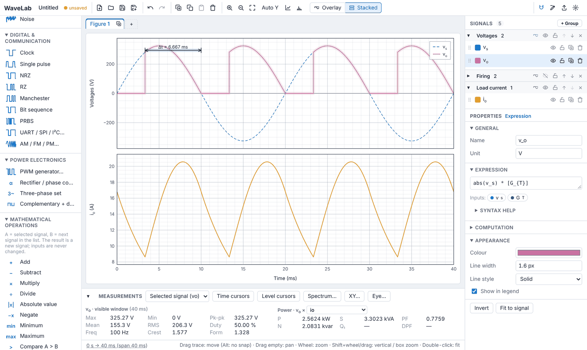

# WaveLab

**Draw, combine and measure waveforms right in the browser, then drop a clean figure into your report.**

WaveLab is a waveform editor for engineers, teachers and students. Start from a sine or a PWM inverter, a
UART frame or a scope capture; shift signals in time, combine them with simple expressions, read the numbers
you would read on a bench, and export a figure that is ready for a paper, a datasheet or a slide.
Nothing to install, no account, nothing uploaded.

**▶ Open the app: <https://gaetanolongo.github.io/WaveLab/>**



## Guides
| | |
|---|---|
| **[Quick start](docs/quick-start.md)** | Ten minutes from an empty screen to a measured, annotated figure; three worked recipes (PWM inverter, scope data, UART frame). |
| **[Feature guide](docs/features.md)** | Everything the app can do, by task: signals, editing, measurements, spectrum, power electronics, protocols, export, sharing. Includes the expression reference. |
| [Conventions](docs/CONVENTIONS.md) | Exact meaning of phase, amplitude, filters, PWM and the other modelling choices. |

## What it feels like
- **Numbers you can trust at a glance.** A 50 % square wave reads 50.00 %, a 3 V sine reads 3 V, and edges
  stay razor-sharp however far you zoom in.
- **Everything stays connected.** A PWM set, a rectifier or an I²C frame is made of ordinary signals and
  expressions. Change one parameter and everything built from it follows.
- **Figures that need no touch-up.** Overlay or stacked plots, groups, several figures, math in labels,
  arrows and dimension markers. What you see on screen is what you export.
- **Hands-on editing.** Drag a trace and it snaps to edges and peaks; scroll to zoom; right-click for the
  actions that fit. Undo and redo everything.
- **Scope-style measurements.** Rise and fall time, pulse width, overshoot, settling time, duty, frequency,
  RMS, THD and power, live as you edit.
- **Your own data too.** Drop an oscilloscope CSV on the window, overlay it with the ideal waveform and
  measure both.
- **Share in one click.** A link opens your project on someone else's screen. The project travels inside the
  link: no upload, no account.
- **Stays responsive.** A calculation that would take too long is abandoned with an explanation instead of
  freezing the page.
- **Private.** Projects are small, readable files on your disk. There is no server, no account and no tracking.

## What is inside
| Area | Highlights |
|---|---|
| Signals | sine, square, pulse, triangle, sawtooth, DC, exponential, damped sine, custom tables, chirp, noise, clock, NRZ / RZ / Manchester, PRBS |
| Operations | add, multiply, compare, logic, rectify, clip, delay, integrate, differentiate, moving average and RMS, RC and RLC filters, quantize, sample & hold, free expressions |
| Measurements | cursors, interval statistics, edges and pulses, power, harmonic spectrum with THD, XY and eye views |
| Power electronics | PWM generator (half, full and three-phase bridges, dead time, load currents), rectifiers and phase control, three-phase sets |
| Communications | AM / FM / PM, UART, SPI and I²C frames with decoded fields |
| Figures | annotations, groups, several figures and a grid view, style presets, LaTeX-style labels |
| Files | PNG, SVG, PDF, CSV and TikZ export; `.wlab` projects; CSV import; share links; recovery copy |
| Devices | desktop, tablet and phone layouts with touch gestures |

## Quick taste
1. Open the app and click **Sine**; type `325` in *Amplitude* and `60` in *Phase*.
2. Add a **Square**, select the sine, and click **Add** under *Mathematical operations*. The sum is a live
   expression you can edit.
3. Open the **Measurements** panel: click **Time cursors** for Δt, or watch *Edges and pulses* for rise time.
4. **Ctrl+S** saves, **Ctrl+Shift+S** exports a figure, **Share** copies a link.

The [quick start](docs/quick-start.md) walks through all of this with pictures.

## Development
Requirements: Node.js 20 or newer (CI uses 22).

```bash
npm install
npm run dev          # development server
npm test             # unit tests (math engine, file format, builders, fuzz tests: 360+ tests)
npm run typecheck
npm run build        # production build in dist/
npx vite preview     # serve the build, then in another shell:
npm run e2e          # browser suites (Playwright, Chromium): features, workflows, measurement accuracy
```
Extra stress runs: `node e2e/stress.e2e.cjs [outDir] [areas]` (every tool, fuzzed fields, exports, layouts,
keyboard, touch, random sessions) and `node e2e/workflows.e2e.cjs` (whole user sessions).

Architecture (TypeScript, React, Vite, Zustand + Immer):
```text
src/core/          pure, framework-free logic (unit-tested)
  model/           document model, defaults, dependencies
  signals/         signal engine: generators, expressions, calculus, filters, compute budget
  expr/            expression parser and printer
  measure/         interval and edge measurements, spectrum, power
  plot/            layout, ticks, sampler, scene → SVG, annotations, XY/eye views, math labels
  snap/            snapping targets and rules
  export/          TikZ / pgfplots
  io/              .wlab files, CSV import, share links
  units/           SI parsing and formatting
src/state/         editor store (undo/redo), compile cache, builders (PWM, rectifier, modulation, protocols)
src/ui/            React components: toolbox, plot, panels, dialogs, export
e2e/               Playwright suites, one per feature area, plus stress and workflow runs
docs/              user guides and CONVENTIONS.md
```
Each signal is a mathematical function with a list of its *features* (jumps, kinks, extrema). Drawing,
snapping, measurements and the spectrum all use that list, which is why edges are exact and numbers are clean.
Long computations run under a time budget (`src/core/signals/budget.ts`).

**Deployment:** `.github/workflows/deploy.yml` type-checks, tests, builds and publishes to GitHub Pages on
every push to `main` (repository Settings → Pages → Source: GitHub Actions).

## Roadmap and history
Ideas under consideration, in no fixed order: an examples gallery, a dark interface, a parameter slider with
live update, offline use (PWA), and faster nested expressions. Your experience with the app decides what
comes first.

<details>
<summary>Completed milestones</summary>

| Milestone | Content |
|---|---|
| M0–M3 | Project setup, signal engine, plot engine, editor interface |
| M4 | Positioning and snapping |
| M5 | Save/open, PNG/SVG/PDF export, math markup, GitHub Pages |
| M6–M7 | Operations, comparators, logic, expression editor; integration, differentiation, moving windows |
| M8–M9 | Cursors and measurements; axes, styles and figure settings |
| M10–M11 | Exponential, damped, piecewise, bit sequences; groups and multiple figures, grid of figures |
| M12 | Harmonic spectrum, THD, CSV export; phone and tablet layout |
| PWM | PWM generator, three-phase set, complementary pairs with dead time |
| S1 | Stabilisation after four stress-test passes |
| F1 | Rectifiers and phase control, SVPWM/DPWM, R-L-E load current, power metrics |
| F2 | Chirp, noise, PRBS, quantize, sample & hold, AM/FM/PM |
| F3 | Annotations, TikZ export, clipboard, LaTeX-style labels |
| F4 | UART/SPI/I²C frames, XY and eye views, RC/RLC filters |
| Round 2 | Right-click menus, resizable panels, keyboard and touch support; compute budget (no more freezes), fast deep operation chains, share links, edge and pulse measurements, CSV import; workflow tests |
</details>

## Credits and licence
WaveLab is released under the [MIT licence](LICENSE).

- Spectrum method and PWM conventions adapted from
  [ModulationToy](https://github.com/GaetanoLongo/ModulationToy) (same author, MIT).
- Inter font (subset), © The Inter Project Authors, SIL Open Font License 1.1 — `public/fonts/Inter-LICENSE.txt`.
- PDF export: [jsPDF](https://github.com/parallax/jsPDF) and [svg2pdf.js](https://github.com/yWorks/svg2pdf.js) (MIT).
