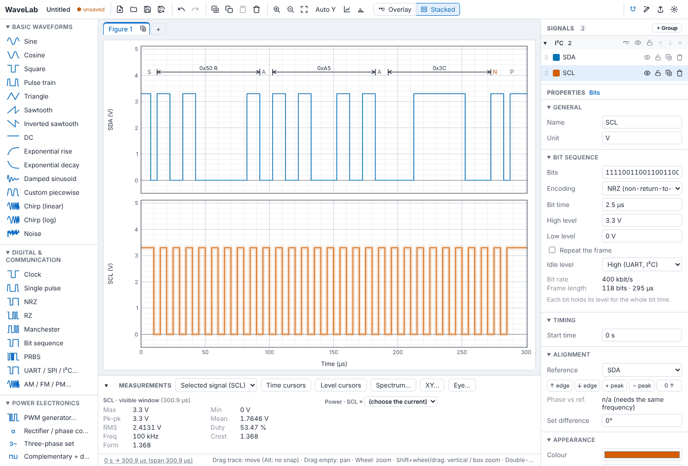
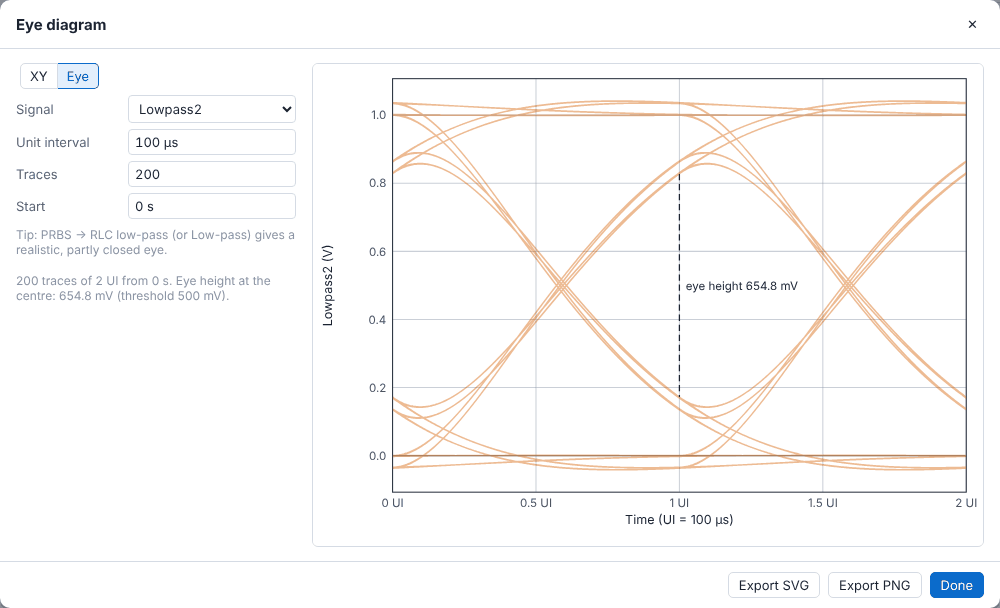

# WaveLab feature guide

Everything WaveLab can do, grouped by what you are trying to get done. New here? Start with the
[quick start](quick-start.md).

- [Create signals](#create-signals)
- [Edit and position](#edit-and-position)
- [Build new signals from old ones](#build-new-signals-from-old-ones)
- [Measure](#measure)
- [Spectrum, XY and eye views](#spectrum-xy-and-eye-views)
- [Bring in measured data](#bring-in-measured-data)
- [Power electronics](#power-electronics)
- [Communications and digital protocols](#communications-and-digital-protocols)
- [Annotate](#annotate)
- [Figures, groups and styles](#figures-groups-and-styles)
- [Export](#export)
- [Save, share and recover](#save-share-and-recover)
- [Phones and tablets](#phones-and-tablets)
- [Expression language](#expression-language)
- [Good to know](#good-to-know)

---

## Create signals

Click a tool in the **toolbox** (left). The new signal appears in the plot and in the signal list, and its
settings open under *Properties*.

| Group | What you get |
|---|---|
| **Basic** | sine, cosine, square (with duty cycle), pulse train (rise and fall times), triangle, sawtooth (rising and falling), DC |
| **Transient** | exponential rise and decay, damped sinusoid, custom piecewise (a table of points: straight lines or steps, optional repeat) |
| **Sweeps and noise** | chirp (linear or logarithmic sweep), noise (Gaussian or uniform; the same noise every time, so figures are reproducible) |
| **Digital** | clock, single pulse, bit sequences (NRZ, RZ, Manchester, idle low or high), PRBS-3 to PRBS-15 |

Every waveform has a **start time** (delay), optional **time windows** (only an interval, or only N cycles) and,
for periodic ones, frequency or period and phase. The properties panel shows handy read-outs, such as the
10–90 % time of an exponential or the bit rate of a bit sequence.

*PRBS is not random:* it is the standard maximal-length shift-register sequence, so it is identical on every
run and every computer.

## Edit and position

- **Drag a trace** to shift it in time. It *snaps* to edges, zero crossings, peaks, cycle starts, the time
  grid or phase steps. The magnet button chooses what to snap to; hold **Alt** to move freely.
- **Alignment** (in Properties): align an edge or peak to another signal, or read and set the phase
  difference between two signals.
- **Undo / redo** for every edit, plus duplicate, copy / paste, lock (protects a signal from edits and deletion),
  hide, invert and rename (with subscripts: `V_{out}`).
- **Right-click** a trace, an annotation, the plot background or a signal in the list for a menu of the
  actions that apply. Keyboard users: **Shift+F10** on a focused signal.
- **Panels**: the toolbar buttons *Toolbox*, *Properties* and *Measure* hide and show the side panels. Drag
  their edges to resize them (double-click an edge to reset). Your layout is remembered.
- **Legend**: a toolbar toggle (and a context-menu entry) shows or hides the legend of the current figure.

## Build new signals from old ones

The *Mathematical operations* section makes a **new signal** from the selected one (A) and the next one in
the list (B). The inputs are never changed, and the result **stays linked**: edit an input and everything built
from it updates.

| Operations | |
|---|---|
| Arithmetic | add, subtract, multiply, divide, absolute value, negate, minimum, maximum |
| Comparison and logic | compare A > B, AND, OR, XOR, NOT |
| Shaping | half-wave and full-wave rectify, clip / saturate, delay |
| Calculus | integration, differentiation (ideal edges show up as labelled arrows), moving average, moving RMS |
| Filters | low-pass and high-pass (RC), RLC low-pass and band-pass (second order) |
| Sampling | quantize (ADC steps), sample & hold |
| Anything else | **Expression…** opens a free-form editor with autocomplete |

Every result is an *expression* you can read and edit (see the [language reference](#expression-language)).
Filters show the steady state of the circuit, as a converter reaches after its start-up; give a start time
and initial value to see the start-up transient instead.

## Measure

The **Measurements** panel under the plot always shows the selected signal over the visible window:

- **Basic**: max, min, peak-to-peak, mean, RMS, frequency, duty cycle, crest factor, form factor.
- **Edges and pulses** (like an oscilloscope): rise and fall time (10–90 %), positive and negative pulse width,
  overshoot, undershoot and settling time (±2 %). The levels are found from the signal itself, so ringing
  does not fool them.
- **Power**: choose a current signal and get active power, apparent power, power factor, reactive and
  non-active power, and the displacement power factor from the fundamentals.
- **Cursors**: *Time cursors* give Δt, 1/Δt and the numbers *between* the two cursors; *Level cursors* give
  ΔY. Drag them, snap to edges and peaks, or type exact positions.

The number to read is meant to be the number you get: 50 % duty reads 50.00 %, a 3 V peak sine reads 3 V,
not 2.998 V.

## Spectrum, XY and eye views

- **Spectrum…** shows the harmonics of any signal as bars and as a table, in peak, RMS, % of fundamental
  or dB, with DC, fundamental, RMS and **THD**. Pick the fundamental and the number of periods; export the
  table as CSV. If the window does not hold a whole number of periods, the dialog says so.
- **XY…** plots one signal against another (Lissajous figures, phase portraits).
- **Eye…** folds a data signal into an eye diagram and reads the eye height. Use it with a PRBS through an
  RLC low-pass for a quick signal-integrity picture. Both views export to SVG and PNG.

If a spectrum would take too long (a window with a very large number of edges) the dialog stops after
8 seconds, keeps its controls, and suggests a higher fundamental, fewer periods or a lower maximum order.

## Bring in measured data

**Import CSV data…** (or drag a `.csv`, `.tsv`, `.txt` or `.dat` file onto the window) turns an oscilloscope
or logger export into ordinary signals.

- The **time column** and its **unit** are found from the header (`Time (ms)`, `t [us]`).
- Commas, semicolons, tabs or spaces as separators; decimal point or decimal comma; comment lines and a
  header row are fine. Lines that are not numbers are skipped and counted.
- Pick which columns to import, the signal unit, and *straight lines* or *steps* between samples.
- Files with more than **150 000 rows** are reduced automatically while keeping every peak.
- The result is a group of normal signals: measure them, take their spectrum, filter them, overlay an ideal
  waveform, annotate and export.

Very long tables are not listed point by point in Properties (the table would be unusable); the panel says
how many points there are.

## Power electronics

- **PWM generator…**: half bridge, full bridge (bipolar or unipolar) or three-phase; triangle or sawtooth
  carrier; sinusoidal, third-harmonic, space-vector or discontinuous references; **complementary gates with
  dead time**; optional **R-L(-E) load currents**; and, with dead time, realistic pole voltages that follow
  the current direction. The dialog shows the expected fundamental and the carrier ratio before you
  create anything. A reference frequency of 0 gives a DC reference for single-phase topologies.
- **Rectifier / phase control…**: half-wave and bridge rectifiers with diodes or thyristors (firing angle),
  continuous-current bridges, AC voltage controllers and three-phase diode and thyristor bridges, with the
  textbook mean and RMS shown as a check, and an optional load current.
- **Three-phase set** and **Complementary + dead time** make a balanced three-phase source, or a gate pair with
  a dead time, from any signal.

Everything created is an ordinary signal in named groups, so you can edit a gate expression, change the
dead time or the load, and watch measurements and spectra follow.

## Communications and digital protocols

- **AM / FM / PM…**: AM (with envelope), DSB-SC, FM and PM of a sine, square or triangle message. The spectrum
  shows the sidebands.
- **UART / SPI / I²C…**: frames from text or hex bytes, with the decoded fields (bytes, addresses, ACK/NACK,
  START/STOP) labelled on the waveforms. UART offers parity, stop bits and an optional bit clock; SPI covers
  modes 0–3 with MISO; I²C covers read and write.



## Annotate

The **Annotations** button adds **text labels**, **arrows** and **Δt / ΔV dimension markers**. Markers snap to
edges and levels, can be created straight from the cursors, follow zoom and layout changes, and appear in
every export. Double-click one to edit its text, panel, colour, size and line thickness. Where two labels
would collide, the app moves or shortens its own labels rather than printing text on top of text.

## Figures, groups and styles

- **Overlay** shows all signals in one plot; **Stacked** gives each signal its own plot with a shared time axis.
- **Groups** are named, collapsible blocks in the signal list; a group can share one plot panel. Drag signals
  between groups.
- Several **figures** (tabs) each have their own signals, style, axes and zoom. A **grid view** shows several
  figures with linked time axes. Signals belong to the project, so one signal can appear in several figures;
  *Not in this figure* lists the others.
- **Axes**: exact ranges, titles, tick step, decimals, logarithmic scale.
- **Styles**: technical (light or dark), presentation and minimal publication presets, with your own colours,
  fonts, legend position, margins and line widths.
- **Math in labels**: `V_{out}`, `I_{RMS}^2`, `\omega t`, `90^\circ`, `\hat{v}` and about 100 LaTeX symbols;
  `$…$` is accepted, so you can paste labels from a LaTeX document. (Multi-character subscripts need braces:
  `V_{dc}`.)



## Export

**Ctrl+Shift+S** opens the export dialog. What you see on screen is what you get in the file.

| Format | Good for |
|---|---|
| PNG | slides and documents; 1×, 2× or 4×, optional transparent background |
| SVG | vector graphics with editable text |
| PDF | vector, with the font embedded; figure size, A4, A3, Letter or a custom page |
| CSV | the visible signals as numbers, optionally with exact edge times |
| TikZ | pgfplots source for LaTeX (a standalone document or a snippet), typeset in your document's own font |

**Copy** puts the result on the clipboard (PNG as an image, the text formats as text). Cursors can be included,
and a grid of figures exports as one image.

## Save, share and recover

- **Save (Ctrl+S)** writes a `.wlab` project: a small, readable text file holding your definitions, never
  thousands of samples. Chromium-based browsers save back into the same file; other browsers download a copy.
- **Open (Ctrl+O)** checks the file first. A broken or foreign file is refused with a message and your current
  work is never replaced.
- **Share** copies a link that opens your project. The compressed project sits in the address after the `#`:
  nothing is sent to any server and the recipient needs no account. They get their own copy, so their edits
  do not change yours. Long projects make long links, and some chat apps cut those: use the file instead.
- **Recovery**: while you have unsaved changes, a copy is kept in your browser and offered at the next start.
  Closing the tab with unsaved work asks for confirmation.
- **Privacy**: there is no server, no account and no tracking by the app. Your projects stay on your computer.

## Phones and tablets

Below 760 px wide (and on phones in landscape), the plot shares the screen with tabbed panels: *Add*,
*Signals*, *Properties* and *Measure*. Pinch to zoom, drag with one finger to move a trace or pan, double-tap
to fit. Touch targets are larger, and dialogs fit the screen.

## Expression language

Expressions refer to other signals by name (`Vin`, or `[Sine 2]` for names with spaces) and to time as `t`.
Numbers accept SI prefixes (`1m`, `4.7u`, `10k`, `2M`). `Name = expression` renames the result.

| Kind | Syntax |
|---|---|
| Arithmetic | `+ - * / ^`, parentheses, `pi`, `e` |
| Comparison and logic | `> < >= <=`, `&& \|\| !`, `and(a, b, …)`, `or(…)`, `xor(a, b)`, `not(x)`, `step(x)` |
| Math | `abs`, `min`, `max`, `clip(x, lo, hi)`, `sqrt`, `exp`, `ln`, `log10`, `sin`, `cos`, `tan`, `sign` |
| Time | `delay(x, d)` |
| Calculus | `integral(x, t0, y0)`, `deriv(x)`, `dfinite(x, tr)`, `dnum(x, h)` |
| Windows | `movavg(x, W)`, `rms(x, W)` |
| Filters | `lowpass(x, τ)` or `lowpass(x, τ, t0, y0)`, `lowpass2(x, f0, Q)`, `bandpass2(x, f0, Q)`, `highpass2(x, f0, Q)` |
| Sampling | `quantize(x, q)`, `zoh(x, Ts)` |

```text
Pin   = Vout * Iout
PWM   = [v_ref] > Carrier
Vrect = abs(Vs)
iL    = integral((48 * G - 12) / 100u, 0, 0)     // buck-converter inductor current
iRL   = lowpass(Vab / 10, 20m / 10)              // R-L load current, steady state
Vc    = lowpass2(Vin, 1k, 0.707)                 // series RLC: capacitor voltage
ADC   = zoh(quantize(Vin, 3.3 / 256), 100u)      // 8-bit sampled and held
```

Results that are logic signals use configurable high and low levels. Mistakes are marked at the position of
the error with a short explanation.

## Good to know

- **Heavy calculations are abandoned, not frozen.** If one signal needs more than about 3 seconds to evaluate
  (a moving average over a very long window, a filter over thousands of switching cycles), the app leaves it
  out of the drawing, says so in the status bar, and stays usable. Shorten the window or simplify the signal.
- **Limits**: times within ±10⁶ s, frequencies from 1 µHz to 1 THz, values up to 10¹⁵. Fields refuse values
  outside these.
- **Models are idealised**: dead-time output follows the current direction of the ideal load current;
  thyristor circuits with inductive loads assume continuous conduction; labels support markup but not
  fractions or roots; the TikZ export covers one figure and leaves out impulse arrows.
- **Conventions** (amplitude is zero-to-peak, +φ leads, a positive delay moves a signal later, and so on)
  are written down in [CONVENTIONS.md](CONVENTIONS.md).
