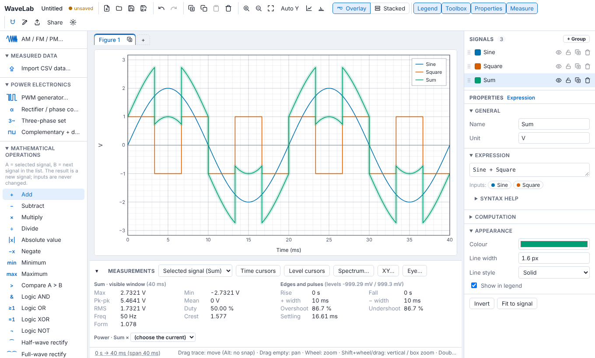
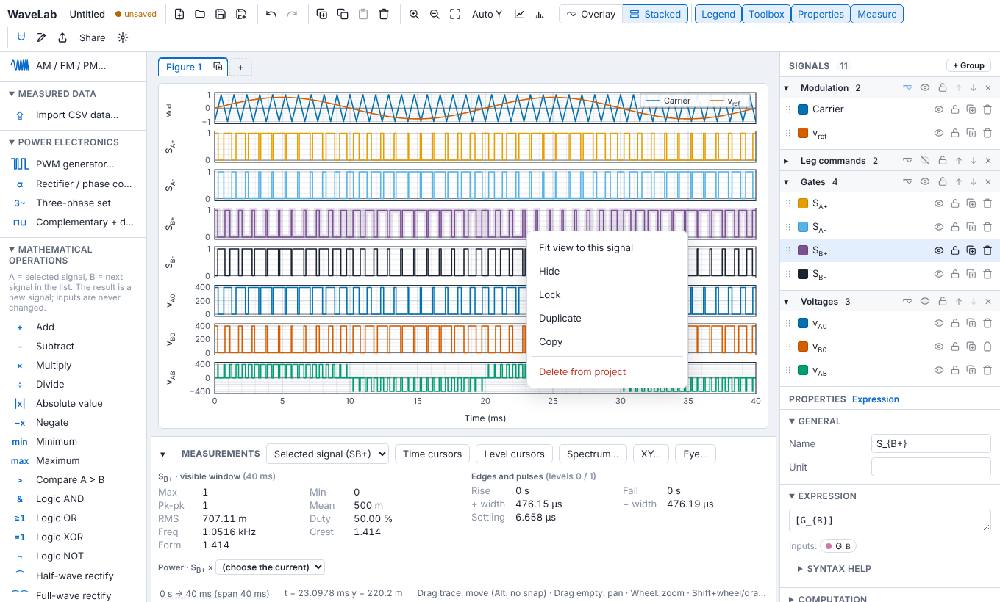
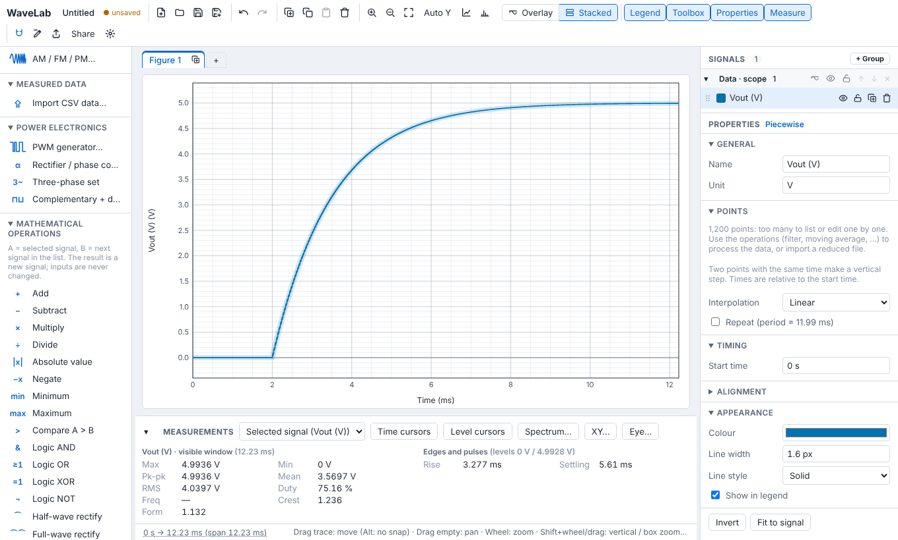
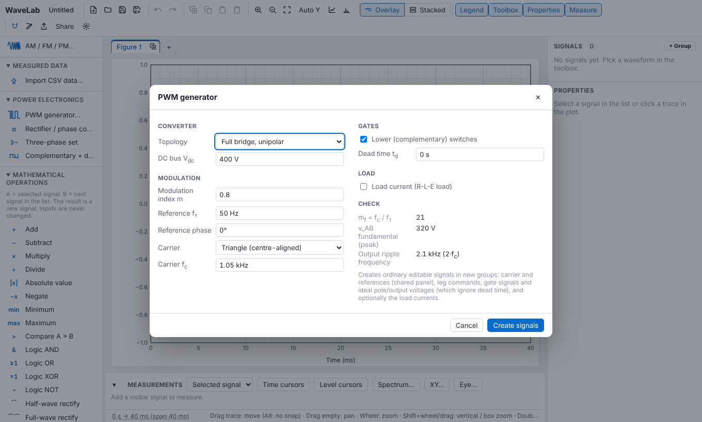
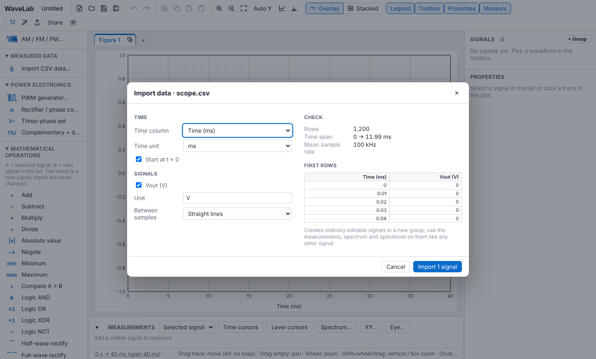

# WaveLab quick start

Ten minutes from an empty screen to a measured, annotated figure you can put in a report.
Open the app first: **<https://gaetanolongo.github.io/WaveLab/>**. There is nothing to install and no
account to create. For a complete tour of everything the app can do, see the
[feature guide](features.md).

- [1. Your first signal](#1-your-first-signal)
- [2. Combine signals](#2-combine-signals)
- [3. Move, zoom and look around](#3-move-zoom-and-look-around)
- [4. Read the numbers](#4-read-the-numbers)
- [5. Mark up the figure](#5-mark-up-the-figure)
- [6. Save, export and share](#6-save-export-and-share)
- [Three recipes](#three-recipes)
- [When something looks wrong](#when-something-looks-wrong)
- [Cheat sheet](#cheat-sheet)

*The screen: toolbox on the left, the plot in the middle, the signal list and properties on the right,
the measurements underneath.*

## 1. Your first signal

1. Click **Sine** in the toolbox. A 50 Hz, 1 V sine appears and is selected.
2. On the right, under *Properties*, change **Amplitude** to `2` and press Enter. The plot follows at once.
3. Try **Frequency** `1k`, then `250`, then back to `50`. Numbers accept the usual prefixes:
   `m` (milli), `u` (micro), `k` (kilo), `M` (mega), for example `2.5m`, `4.7u`, `10k`.
4. Press **Ctrl+Z** to undo a change, **Ctrl+Y** to redo it. Nothing you do in the editor is final.

Every signal in the **list** (top right) has buttons to hide, lock, duplicate and delete it. Double-click
a name to rename it. Names understand subscripts: type `V_{out}` and you get V with a subscript *out*.

## 2. Combine signals

1. Click **Square** in the toolbox, and set its *Frequency* to `150`.
2. Click **Sine** in the signal list, then click **Add** under *Mathematical operations*.
   A third signal, **Sum**, appears. The tool combines the *selected* signal (A) with the *next* one in
   the list (B); the originals are never changed.
3. Look at the **Expression** box in *Properties*: it reads `Sine + Square`. You can edit it. Try
   `Sine * Square`, or `abs(Sine)`, or `Sine > 0.5`. Click the *Syntax help* line to see every function.

If you change the sine's amplitude now, **Sum updates by itself**. That is how everything in WaveLab
works: results stay connected to what they were made from.

## 3. Move, zoom and look around

| You want to | Do this |
|---|---|
| Zoom in or out in time | scroll the wheel over the plot |
| Zoom the vertical axis | Shift + wheel |
| Zoom into a box | Shift + drag |
| Pan | drag the empty background |
| See everything again | double-click the plot (or the *Fit* button) |
| Shift a signal in time | drag its trace; it snaps to edges, peaks and zero crossings. Hold **Alt** for a free move |
| Switch layout | **Overlay** (all on one plot) or **Stacked** (one plot per signal, shared time axis) |

On a phone or tablet: pinch to zoom, drag with one finger to pan or move a trace, double-tap to fit.

Right-click (or press **Shift+F10** on a signal in the list) for a context menu with the actions that
make sense for what you clicked.

## 4. Read the numbers

The **Measurements** panel under the plot is always live for the selected signal and the visible window:

- **Max, Min, Pk-pk, Mean, RMS, Freq, Duty, Crest, Form**: the usual lab numbers. A 50 % square wave shows
  *50.00 %*, not 49.87 %.
- **Edges and pulses**: rise time, fall time (10–90 %), pulse widths, overshoot, undershoot and settling
  time, like an oscilloscope's automatic measurements.
- **Power**: choose a current signal next to *Power* to get P, S, power factor and more for a voltage.

Click **Time cursors** to place two vertical cursors (drag them; they snap to edges and peaks). You read
Δt, 1/Δt and all the numbers *between* the cursors. **Level cursors** do the same for voltage. **Spectrum…**
opens the harmonic table and THD; **XY…** and **Eye…** open Lissajous and eye-diagram views.

*The measurements of a measured RC step response: rise 3.28 ms, settling 5.6 ms.*

## 5. Mark up the figure

Click the **Annotations** button (pencil) in the toolbar and choose a label, an arrow or a **Δt / ΔV
dimension marker**, then click in the plot. Markers snap to edges and levels; double-click one later to edit
its text, colour and thickness. Press **Delete** to remove the selected one. Annotations are drawn in every
export.

Other touches that make a figure presentable: **Figure settings** (style presets, fonts, legend position,
colours), **Axes** (exact ranges, titles, log scale) and math in any label (`V_{DC}`, `\omega t`, `90^\circ`).

## 6. Save, export and share

| Button / shortcut | What it does |
|---|---|
| **Ctrl+S** | Save the project as a `.wlab` file (a small, readable text file). Chromium-based browsers save back to the same file; other browsers download a copy. |
| **Ctrl+O** | Open a `.wlab` file. A damaged file is refused with a message and your current work stays untouched. |
| **Ctrl+Shift+S** | Export the figure as PNG, SVG, PDF, CSV or TikZ (LaTeX). The export looks like the screen. |
| **Share** | Copies a link that opens your project. The project is *inside* the link: nothing is uploaded and nobody needs an account. Very long projects make very long links; if your chat app cuts it, send the file. |

If the tab is closed or crashes with unsaved work, WaveLab offers to restore it at the next start.

## Three recipes

### A. A PWM inverter in four clicks

1. Click **PWM generator…** in the *Power electronics* section.
2. Pick a topology (e.g. *Full bridge, unipolar*), then set the DC bus, the modulation index and the
   frequencies. The *Check* box on the right shows the expected output fundamental before you create anything.
3. Tick **Load current** to add an R-L(-E) load, and set a **dead time** if you want realistic gate signals.
4. Click **Create signals**.

You get groups of ordinary signals (carrier and reference, gate signals, voltages, currents). Select the
output voltage, open **Spectrum…** for its harmonics, or change any gate expression and watch the rest follow.
For very high carrier frequencies with dead time and a load, creation can take several seconds; the
dialog warns you and the first view shows 100 carrier cycles.

### B. Compare measured data with theory

1. Click **Import CSV data…** under *Measured data*, or drop a `.csv` file on the window.
2. Check the dialog: the **time column** and its **unit** (for example `Time (ms)`) are found from the
   header. Commas or semicolons, decimal point or decimal comma are all understood. Press **Import**.
3. Your measurement is now an ordinary signal. Select it and read its rise time in *Edges and pulses*, or
   create an ideal signal next to it (an **Exponential rise**, say) and overlay both.
4. Files with more than 150 000 rows are reduced automatically while keeping every peak.

### C. A UART, SPI or I²C timing diagram

1. Click **UART / SPI / I²C…**, choose the protocol and type your data as text or hex bytes
   (for example `Hello!` for UART, `A5 3C` for SPI).
2. Click **Create signals**. The decoded bytes, addresses, ACK/NACK and START/STOP are labelled on the waveforms.
3. Zoom in on a byte to see the bit boundaries, then export the figure as SVG or PDF for your datasheet.

## When something looks wrong

- **"A signal is too heavy to compute (over 3 s) and was left out"**: the app gave up on a calculation instead of
  freezing. Typical causes are a moving average over a very long window, or a filter over thousands of
  switching cycles. Zoom in, shorten the window, or reduce the carrier frequency, then try again.
- **A file or link will not open**: you get a message naming what is wrong, and your current project is
  not replaced.
- **You deleted something**: **Ctrl+Z**. A signal that other signals depend on cannot be deleted; a popup
  lists the dependents.
- **A signal is "Not in this figure"**: signals belong to the project and can be shown in several figures;
  the list keeps unused ones so you can bring them back or delete them.
- **Panels in the way**: the toolbar buttons *Toolbox*, *Properties* and *Measure* hide and show the side
  panels; drag their edges to resize them.
- **The exact meaning of a number** (phase sign, amplitude convention, how a filter starts) is written down
  in [CONVENTIONS.md](CONVENTIONS.md).

## Cheat sheet

| Shortcut | Action |
|---|---|
| Ctrl+S / Ctrl+Shift+S / Ctrl+O | save / export / open |
| Ctrl+Z, Ctrl+Y (or Ctrl+Shift+Z) | undo, redo |
| Ctrl+C, Ctrl+V, Ctrl+D | copy, paste, duplicate the selected signal |
| Delete | delete the selected annotation or signal |
| Esc | cancel, deselect, close a dialog |
| Shift+F10 | context menu for the focused signal in the list |
| Alt while dragging | move without snapping |
| Wheel / Shift+wheel / Shift+drag | zoom time / zoom vertical / zoom box |
| Double-click the plot | fit everything |

Hover over any button or field for a short explanation. On a Mac, use ⌘ instead of Ctrl.
